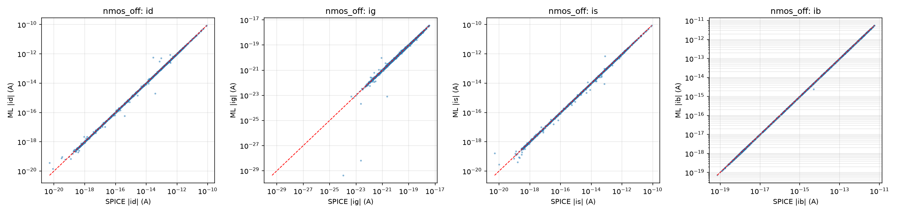
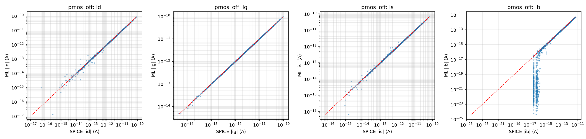
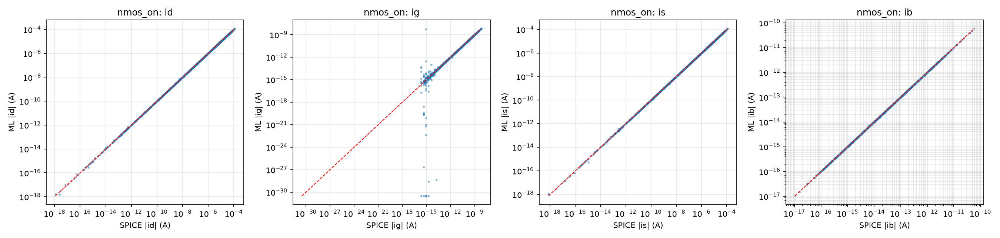
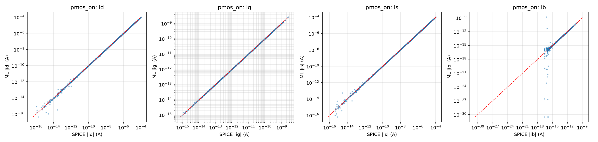
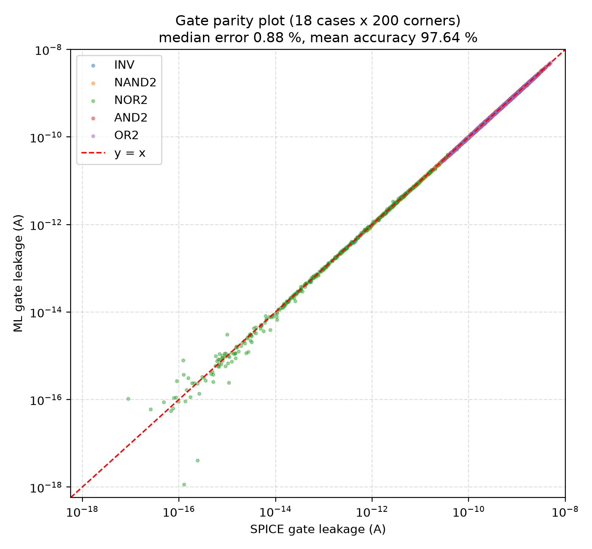
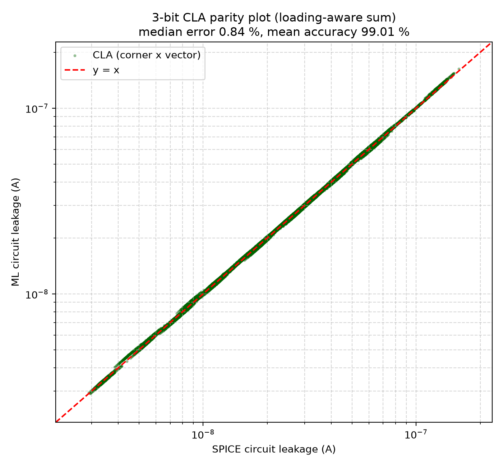
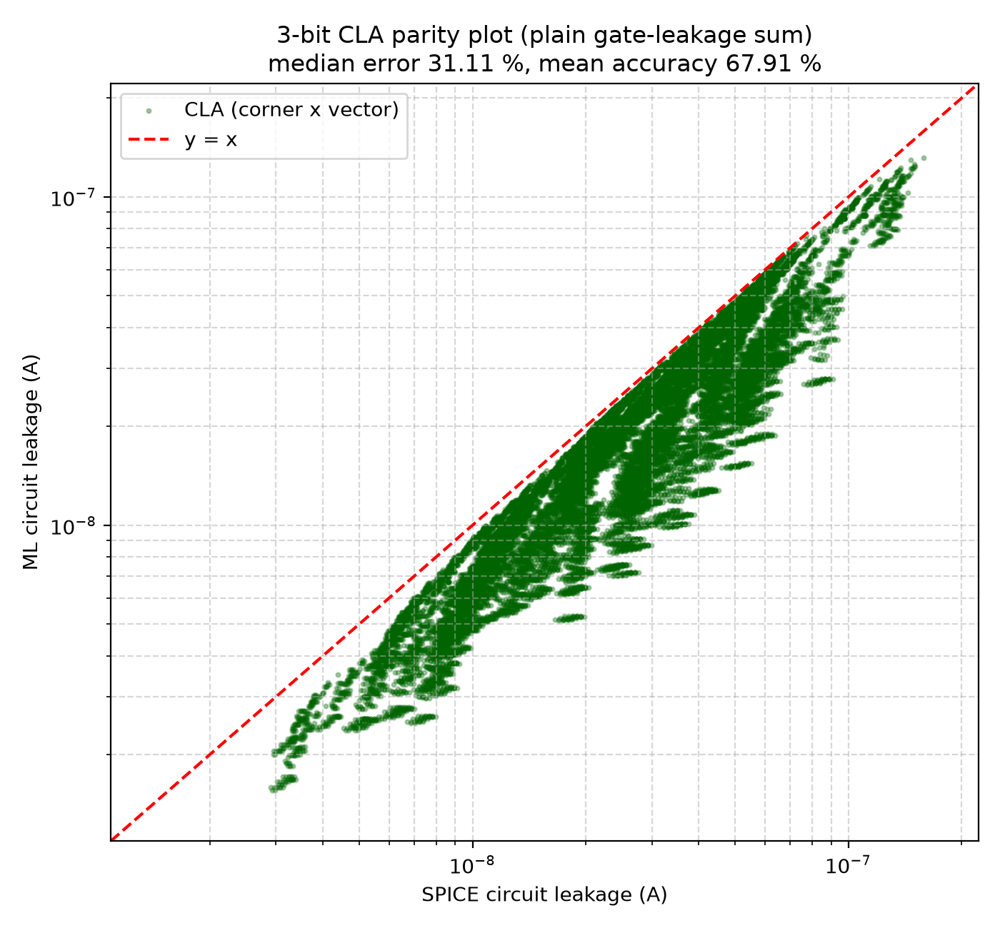
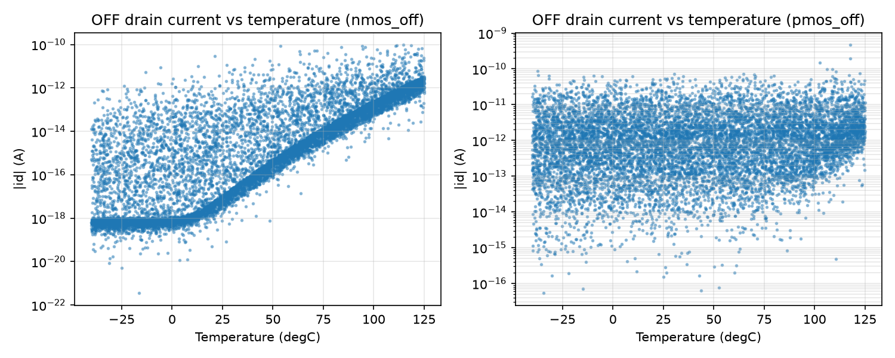
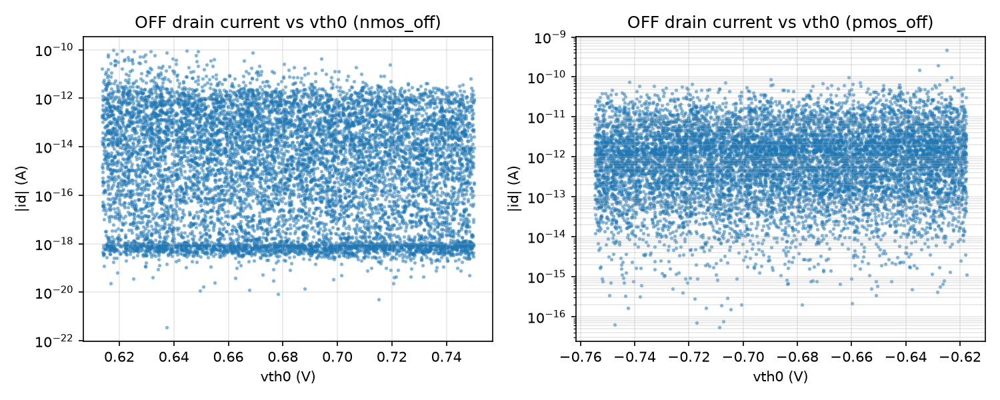
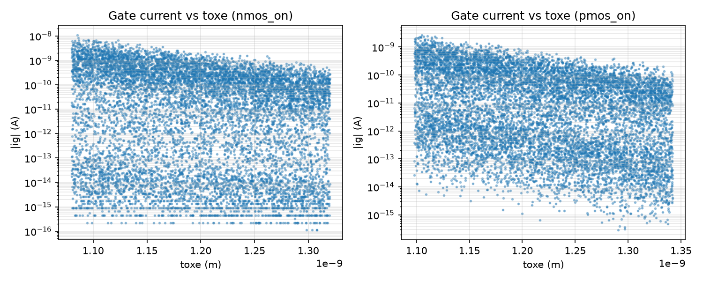

# ML-Driven PVT-Aware Leakage Estimation
## 16 nm Low-Power CMOS, 3-Bit Carry-Lookahead Adder (CLA)

Single-transistor SPICE simulations are used to train machine-learning models that predict all four
terminal currents (Id, Ig, Is, Ib) under process, voltage and temperature (PVT) variation. These models
are composed hierarchically to predict the static leakage of CMOS gates (INV, NAND2, NOR2, AND2, OR2)
and of a 42-gate 3-bit carry-lookahead adder. Every prediction is checked against ngspice.

### Project specifications

| Parameter | Assigned value | Implementation |
|---|---|---|
| Technology node | 16 nm LP | PTM BSIM4 model `models/16nm_LP.pm` |
| Nominal supply voltage | 1.0 V (assigned) | swept 0.90 V to 1.10 V. The model file's comment says 0.9 V nominal; the assigned 1.0 V is used |
| Channel length | 16 nm | Lmin = 16e-9 m |
| Training widths | 16 nm to 128 nm | 1x to 8x Lmin |
| Gate transistor sizing | NMOS 32 nm, PMOS 64 nm | WN = 2 Lmin, WP = 4 Lmin |
| Diffusion | Ldiff = 40 nm | AD = AS = W x Ldiff, PD = PS = 2 (W + Ldiff) |
| Process variation | +-10 % | vth0, toxe, ndep, u0, xj (separate for NMOS and PMOS) |
| Temperature | -40 to 125 C | |
| Test circuit | 3-bit CLA | 42 gates, 128 input vectors |
| Simulator | ngspice 42 | `.options gmin=1e-18 abstol=1e-18 reltol=1e-6 vntol=1e-9` |

### Summary of results

| Level | Method | Median error | Mean accuracy |
|---|---|---|---|
| Part A: transistors | MLP (PyTorch, GPU) chosen for 15 of 16 currents | 0.3 % to 1.8 % (test set; two tiny currents higher, see below) | about 99 % |
| Part B: gates | exact KCL on predicted terminal currents | **0.88 %** (all 3,600 runs) | **98.3 % to 99.2 % in 16 of 18 cases** |
| Part C: CLA, plain sum | sum of gate leakages (project method) | 31.1 % | 67.9 % |
| Part C: CLA, loading-aware | plain sum + gate-input currents of HIGH internal nets | **0.84 %** | **99.01 %** |
| Part C check (no ML) | SPICE gate results, loading-aware sum | 0.008 % | 99.99 % |

Mean accuracy = 100 % - mean of |ML - SPICE| / SPICE over all runs.

The last row shows that the composition method itself is exact: built from SPICE gate results it
reproduces the full-circuit SPICE leakage to 0.008 %. So the remaining 0.8 % in Part C is ML error.
The plain sum misses about 31 % because, in the full circuit, the gate-tunnelling current drawn by gate
inputs is supplied from VDD by the driving gate, while in a stand-alone gate it comes from the ideal input
source (the project text notes that ignoring loading lowers accuracy).

### Part A: transistor models (Deliverables 1 to 5)

* 4 datasets x 10,000 uniform random samples (`data/<case>.csv`) plus 10,000 extra rail-focused training
  samples per case (`data/rail/<case>.csv`, Vd and Vs concentrated at 0 and VDD, where gates operate).
  Validation and test use only the uniform data (70 / 15 / 15 split, fixed seed).
* Each current is predicted as sign x 10^(log10|I|): a regressor for log10|I| and a sign classifier.
* 4 model types compared: MLP (PyTorch, Adam + L-BFGS, GPU), LightGBM, XGBoost, Random Forest.
  The best type is chosen per current on the validation set.






Validation median error, % (mean over Id, Ig, Is, Ib):

| Model | nmos_on | nmos_off | pmos_on | pmos_off |
|---|---|---|---|---|
| MLP | **0.75** | **1.54** | **0.91** | 13.89 (Ib), else 0.4 to 0.8 |
| LightGBM | 13.08 | 8.05 | 12.49 | 19.13 |
| XGBoost | 12.76 | 7.87 | 12.07 | 18.07 |
| Random Forest | 21.14 | 9.67 | 21.99 | 9.54 |

Test-set median error of the chosen models, %:

| Case | Id | Ig | Is | Ib |
|---|---|---|---|---|
| nmos_on | 0.66 | 1.74 | 0.60 | 0.30 |
| nmos_off | 0.91 | 3.59 | 1.24 | 0.32 |
| pmos_on | 1.08 | 0.34 | 0.93 | 1.46 |
| pmos_off | 0.85 | 0.39 | 0.76 | 9.30 (Random Forest) |

The two weaker values are tiny currents: the OFF-NMOS gate current (about 1e-20 A, 3.6 %) and the
OFF-PMOS body current (about 1e-17 A, 9.3 %, at the simulator's numerical noise floor, which also makes
its sign almost random).
Neither matters for gate leakage.

### Part B: gate validation (Deliverables 6 and 7)

18 gate cases x 200 random corners (seed 123). Gate leakage = current from VDD. The ML value is exact KCL
at the VDD side on the predicted terminal currents (`scripts/gates.py`); with SPICE single-transistor
currents instead of ML this formula matches the gate SPICE to about 0.0002 %.

| Gate | Input | SPICE median (A) | ML median (A) | Bias (%) | Median err (%) | Mean err (%) | P95 err (%) | Mean accuracy (%) |
|---|---|---|---|---|---|---|---|---|
| INV | 0 | 2.251e-10 | 2.252e-10 | 0.65 | 0.75 | 0.83 | 1.80 | 99.17 |
| INV | 1 | 1.490e-11 | 1.511e-11 | 0.29 | 1.38 | 1.66 | 4.25 | 98.34 |
| NAND2 | 00 | 4.088e-10 | 4.093e-10 | 0.62 | 0.73 | 0.79 | 1.75 | 99.21 |
| NAND2 | 01 | 2.251e-10 | 2.252e-10 | 0.65 | 0.75 | 0.83 | 1.80 | 99.17 |
| NAND2 | 10 | 2.106e-10 | 2.118e-10 | 0.65 | 0.78 | 0.81 | 1.70 | 99.19 |
| NAND2 | 11 | 2.980e-11 | 3.021e-11 | 0.29 | 1.39 | 1.66 | 4.25 | 98.35 |
| NOR2 | 00 | 4.503e-10 | 4.496e-10 | 0.53 | 0.66 | 0.78 | 1.69 | 99.22 |
| NOR2 | 01 | 2.508e-10 | 2.527e-10 | 0.49 | 0.68 | 0.80 | 1.74 | 99.20 |
| NOR2 | 10 | 8.504e-13 | 8.639e-13 | 0.27 | 1.85 | 3.23 | 8.17 | 96.77 |
| NOR2 | 11 | 1.718e-14 | 1.724e-14 | 0.57 | 5.95 | 24.92 | 76.64 | 75.08 |
| AND2 | 00 | 9.008e-10 | 9.020e-10 | 0.56 | 0.83 | 0.93 | 2.24 | 99.07 |
| AND2 | 01 | 6.731e-10 | 6.667e-10 | 0.64 | 0.88 | 1.03 | 2.53 | 98.97 |
| AND2 | 10 | 6.544e-10 | 6.572e-10 | 0.62 | 0.88 | 1.04 | 2.53 | 98.96 |
| AND2 | 11 | 3.154e-10 | 3.198e-10 | 0.45 | 0.63 | 0.80 | 1.78 | 99.20 |
| OR2 | 00 | 9.207e-10 | 9.282e-10 | 0.50 | 0.80 | 0.89 | 2.18 | 99.11 |
| OR2 | 01 | 4.871e-10 | 4.853e-10 | 0.58 | 0.68 | 0.79 | 1.76 | 99.21 |
| OR2 | 10 | 2.279e-10 | 2.288e-10 | 0.61 | 0.72 | 0.82 | 1.86 | 99.18 |
| OR2 | 11 | 2.265e-10 | 2.269e-10 | 0.62 | 0.73 | 0.83 | 1.80 | 99.17 |

NOR2 10 and NOR2 11 have very small leakage (two stacked OFF PMOS). NOR2 11 (about 1e-14 to 1e-16 A) is at
the simulator's numerical noise floor: even single-transistor SPICE and gate SPICE differ by about 10 % there,
so its percentage error is not meaningful. 9 of 3,600 gate SPICE runs did not converge and are excluded.



### Part C: 3-bit CLA (Deliverable 8)

200 corners x 128 vectors = 25,600 full-circuit SPICE runs, compared with the gate-level composition.

| Method | SPICE median (A) | ML median (A) | Bias (%) | Median err (%) | Mean err (%) | P95 err (%) | Mean accuracy (%) |
|---|---|---|---|---|---|---|---|
| ML plain sum (project method) | 2.687e-08 | 1.737e-08 | -31.11 | 31.11 | 32.09 | 60.51 | 67.91 |
| ML loading-aware | 2.687e-08 | 2.695e-08 | 0.60 | 0.84 | 0.99 | 2.54 | **99.01** |
| SPICE gate sum, plain (no ML) | 2.687e-08 | 1.735e-08 | -31.49 | 31.49 | 32.47 | 60.53 | 67.53 |
| SPICE gate sum, loading-aware (no ML) | 2.687e-08 | 2.687e-08 | 0.008 | 0.008 | 0.013 | 0.040 | 99.99 |

Loading-aware sum (main result):


Plain sum (project method, ignores loading):


**Why the plain sum is only about 68 %, and why that is expected.** The project text says the plain
gate-sum ignores loading between gates and will be less accurate. The table shows that this gap is not
an ML error: the same plain sum built from SPICE gate results (no ML at all) is also 67.5 %. In this
16 nm LP technology the oxide is only about 1.2 nm thick, so a gate input that is driven HIGH draws a
sizeable tunnelling current. In the full circuit that current is supplied from VDD by the driving gate
(and so it is part of the circuit leakage), while in a stand-alone gate simulation it comes from the ideal
input source and is not counted. Adding these input-pin currents, which are also predicted by the
transistor models, gives the loading-aware sum: 99.01 % with ML and 99.99 % with SPICE values.

### Physical trend checks (Deliverable 3)





Kirchhoff check (`results/part_a/kcl_check.csv`): the four terminal currents sum to zero with a median
relative residual of about 1e-6 in all four cases.

### Deliverables map

| Deliverable | Description | Location |
|---|---|---|
| 1. Datasets | 4 x 10,000 uniform samples; extra rail-focused training samples | `data/<case>.csv`, `data/rail/<case>.csv` |
| 2. Example netlists | transistor, gate and CLA netlists | `netlists/transistor/*.cir`, `netlists/gates/*.sp`, `netlists/circuit/cla3.sp` |
| 3. Data check | Kirchhoff check and trend plots | `results/part_a/kcl_check.csv`, `results/part_a/plots/off_current_vs_*.png`, `results/part_a/plots/gate_current_vs_toxe.png` |
| 4. Model comparison | 4 model types x 4 cases (R2, median, p95) | `results/part_a/model_comparison.csv` (per current), `results/part_a/model_comparison_summary.csv` |
| 5. Chosen models | test-set errors, parity plots, model files | `results/part_a/chosen_models_test.csv`, `results/part_a/plots/parity_<case>.png`, `saved_models/<case>.joblib` |
| 6. Gate results table | 18 cases | `results/part_b/gate_results_table.csv` (all runs: `results/part_b/gate_all.csv`) |
| 7. Gate parity plot | 3,600 runs | `results/part_b/gate_parity_plot.png` |
| 8. Circuit results | per-vector table, summary, raw data, parity plots | `results/part_c/circuit_results_table.csv`, `results/part_c/circuit_summary.csv`, `results/part_c/circuit_raw.csv`, `results/part_c/circuit_parity_plot*.png` |
| 9. Scripts | pipeline with fixed seeds | `scripts/` (see below), `run_all.sh` |
| 10. Report | written report | `report/` |

### Repository layout

```
models/16nm_LP.pm            PTM 16 nm LP model card (assigned)
data/<case>.csv              Part A datasets, 10,000 uniform samples each
data/rail/<case>.csv         extra rail-focused training samples
netlists/                    example netlists: transistor/, gates/, circuit/
saved_models/<case>.joblib   the 4 trained transistor models
results/part_a/              Kirchhoff check, model comparison, test results, plots/
results/part_b/              gate SPICE (cached), gate results table, parity plot
results/part_c/              circuit SPICE cache, per-vector table, summary, parity plots
scripts/                     pipeline (01-05) and shared modules
docs/                        detailed notes for each part and the method
run_all.sh                   runs the whole pipeline and prints a summary
```

| Script | Purpose |
|---|---|
| `scripts/01_generate_transistor_data.py` | Part A datasets (4 cases x 10,000 SPICE runs) and transistor netlists |
| `scripts/01b_generate_rail_data.py` | extra training samples with Vd, Vs near 0 and VDD |
| `scripts/02_check_data.py` | Kirchhoff check and the three trend plots |
| `scripts/03_train_models.py` | trains and compares 4 model types, saves the chosen models |
| `scripts/04_validate_gates.py` | Part B: gate SPICE vs ML for 18 cases x 200 corners |
| `scripts/05_validate_circuit.py` | Part C: 3-bit CLA SPICE vs gate-level composition |
| `scripts/config.py` | all settings (model file, VDD, L, ranges, seeds, SPICE options) |
| `scripts/spice_utils.py` | model-card editing, transistor netlist, ngspice runner |
| `scripts/leak_model.py` | input features and the saved-model wrapper (sign x 10^log10\|I\|) |
| `scripts/torch_mlp.py` | PyTorch MLP (GPU) used as the MLP model type |
| `scripts/gates.py` | gate topologies, gate SPICE, and the KCL gate evaluator |
| `scripts/cla3.py` | 3-bit CLA gate list and logic |

Detailed notes: `docs/part_a_transistor_models.md`, `docs/part_b_gate_validation.md`,
`docs/part_c_circuit_validation.md`, `docs/method_notes.md`.

### Setup

```bash
sudo apt update && sudo apt install -y ngspice python3-venv python3-pip
python3 -m venv venv
source venv/bin/activate
pip install -r requirements.txt     # exact versions used for the results
# PyTorch for GPU training: pick the CUDA build your NVIDIA driver supports, e.g. CUDA 12.8:
pip install torch --index-url https://download.pytorch.org/whl/cu128
```

Without PyTorch the training falls back to the scikit-learn MLP on the CPU (much slower).

### Reproduce

```bash
bash run_all.sh                # everything: data, training, Parts B and C (about 1 h with a GPU)
bash run_all.sh --skip-data    # keep the datasets, re-train and re-run Parts B and C
```

or step by step:

```bash
python scripts/01_generate_transistor_data.py   # Part A datasets (10,000 per case)
python scripts/01b_generate_rail_data.py        # extra rail-focused training data
python scripts/02_check_data.py                 # Kirchhoff check + trend plots
python scripts/03_train_models.py               # 4 model types x 4 cases -> saved_models/
python scripts/04_validate_gates.py             # Part B (gate SPICE cached in results/part_b/)
python scripts/05_validate_circuit.py           # Part C (circuit SPICE cached in results/part_c/spice_cache/)
```
