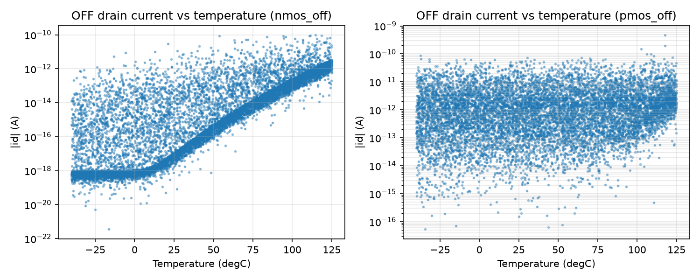
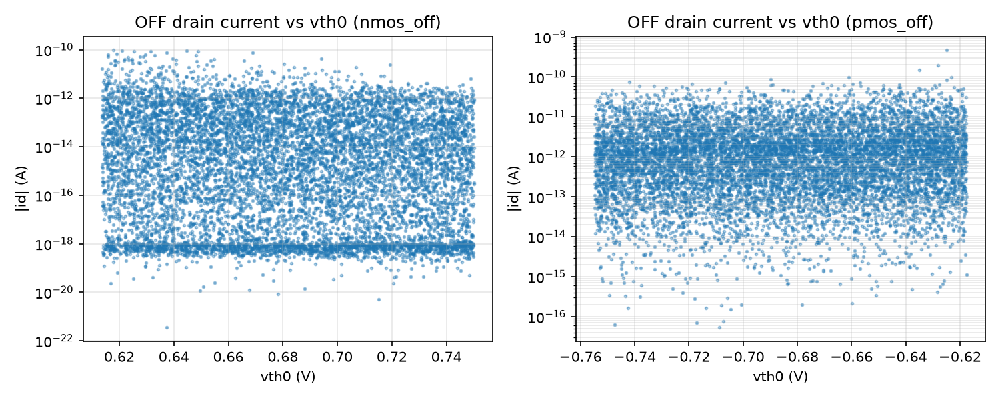
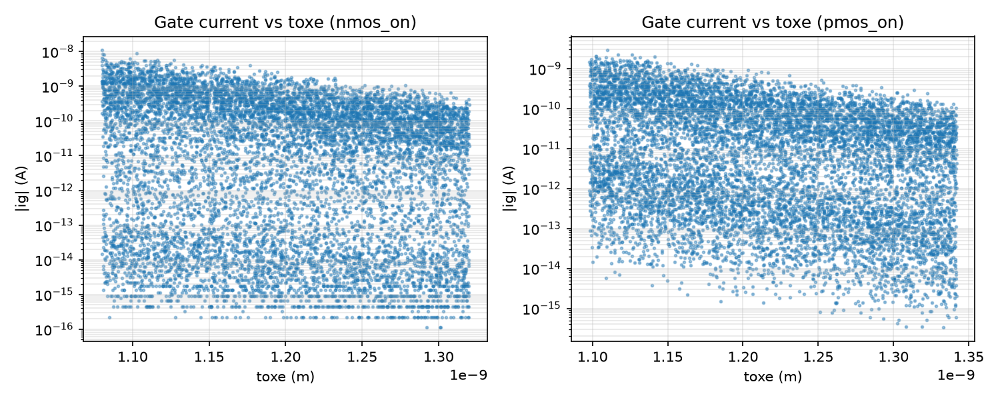
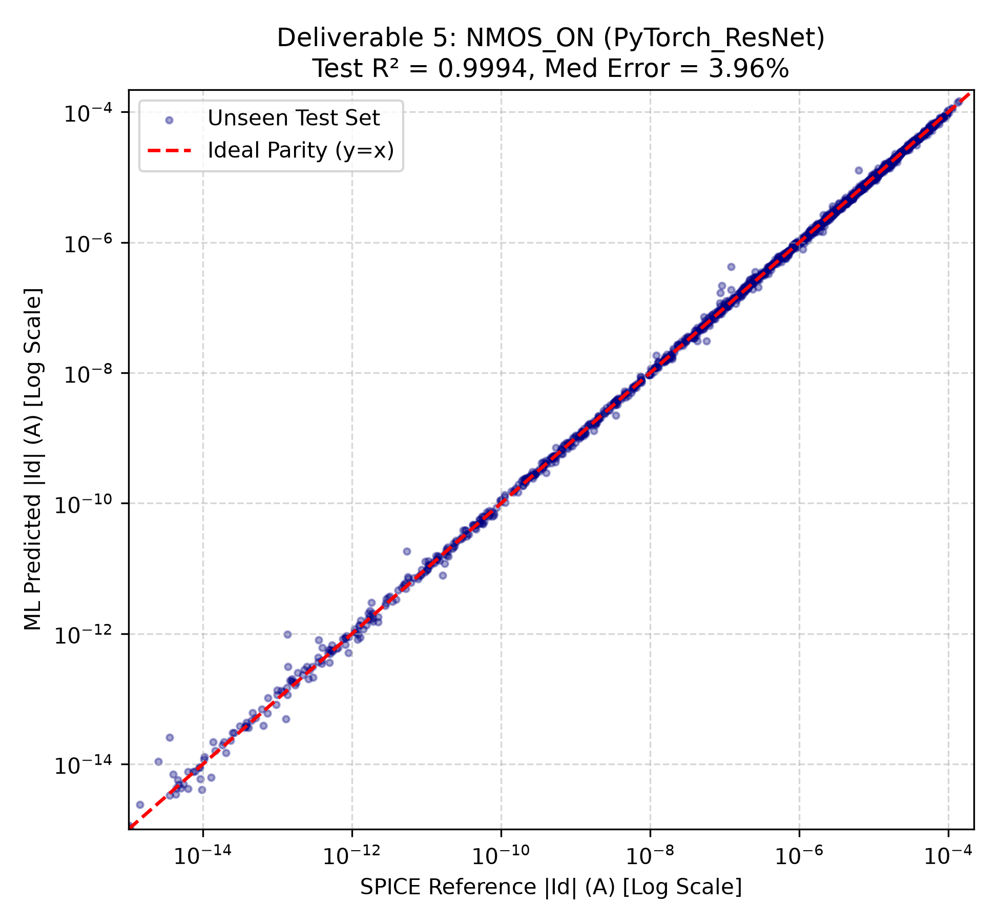
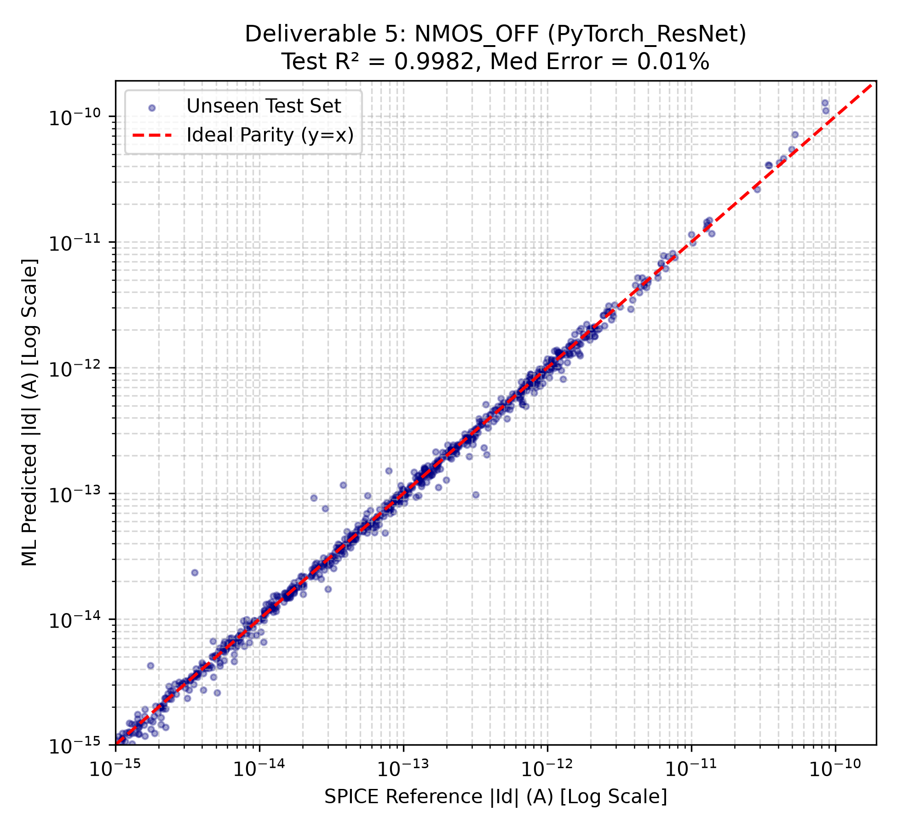
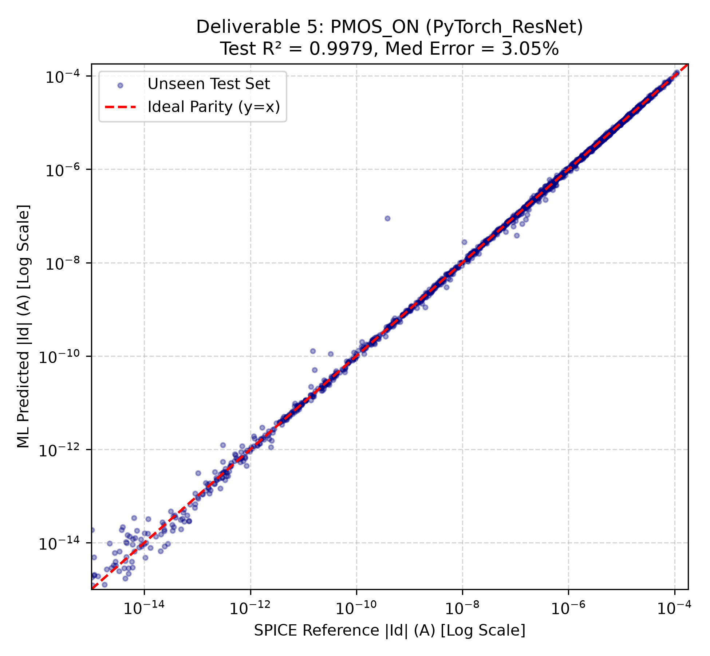
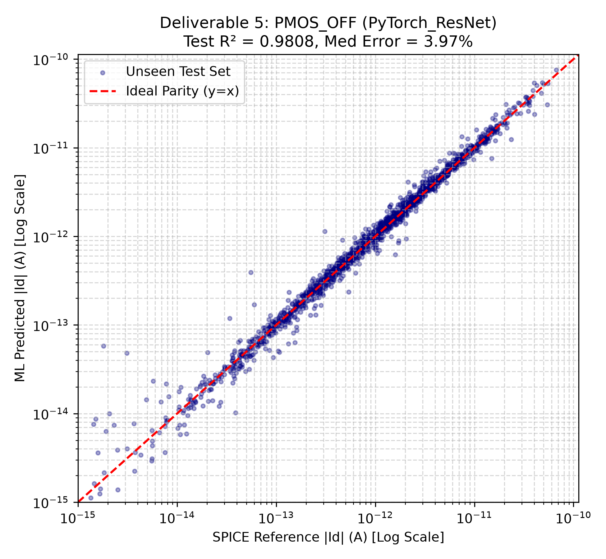

# Part A: Transistor Modeling and Characterization

This part builds four single-transistor datasets with ngspice (BSIM4, 16 nm LP model card), checks them, and trains ML surrogates that predict all four terminal currents. Interpretation of the results (error sources, limitations, model choice) is in `part_a_analysis.md`.

| Step | Script | Output |
|---|---|---|
| 1 | `scripts/01_generate_data.py` | `data/<case>.csv`, `netlists/transistor/<case>.cir` |
| 2 | `scripts/02_data_check.py` | `results/kcl_check.csv`, three trend plots in `results/plots/` |
| 3 | `scripts/03_train_models.py` | `models/best_<case>.joblib`, `results/model_comparison_table.csv`, `results/chosen_models_test_summary.csv`, `results/plots/parity_<case>.png` |

All settings (model file, VDD, L, ranges, seed) are in `scripts/config.py`.

## 1. Characterization Strategy and Parameter Sweeps

For each of four operating states, 10,000 independent single-transistor operating points were simulated:

| State | Vg | Vb |
|---|---|---|
| NMOS ON | VDD | 0 V |
| NMOS OFF | 0 V | 0 V |
| PMOS ON | 0 V | VDD |
| PMOS OFF | VDD | VDD |

Every sample is drawn independently from uniform distributions (base seed 7 in `config.py`; case k uses seed 7 + k):

| Quantity | Range |
|---|---|
| Supply voltage VDD | 0.90 V to 1.10 V (nominal 1.0 V, plus/minus 10%) |
| Drain and source voltages Vd, Vs | each uniform in [0, VDD], drawn after VDD |
| Width W | 16 nm to 128 nm (1x to 8x Lmin, with Lmin = L = 16 nm) |
| Temperature T | -40 C to 125 C |
| Process parameters | plus/minus 10% around the model-card value (below) |

Nominal process values (read from the model card):

* NMOS: vth0 = 0.68191 V, toxe = 1.20 nm, ndep = 7.00e18 cm^-3, u0 = 0.0280 m^2/Vs, xj = 5.0 nm
* PMOS: vth0 = -0.68620 V, toxe = 1.22 nm, ndep = 4.40e18 cm^-3, u0 = 0.0075 m^2/Vs, xj = 7.2 nm

Netlist details (`scripts/spice_utils.py`):

* One transistor `M1` with each terminal tied to its own ideal DC source, solved with `.op` and `set numdgt = 10`.
* Explicit diffusion parasitics with scalable layout rules: Ldiff = 2.5 x Lmin = 40 nm, AD = AS = W x Ldiff, PD = PS = 2 x (W + Ldiff). These give the source and drain junctions non-zero area so reverse-diode leakage and band-to-band tunneling are part of the model.
* Solver tolerances are tightened to `gmin = abstol = 1e-18` (ngspice defaults are 1e-12) with `reltol = 1e-6`, so currents down to about 1e-17 A are resolved.
* Terminal currents entering the device: Id = -i(Vd), Ig = -i(Vg), Is = -i(Vs), Ib = -i(Vb).
* Rows where ngspice fails are dropped (script 01 prints the count per case).
* `netlists/transistor/<case>.cir` holds one illustrative nominal-corner netlist per case (W = 2 x Lmin, Vd = VDD/2, Vs = 0, 27 C). The dataset netlists are generated per row and not kept.

## 2. Kirchhoff Current Law (KCL) Data Audit

By KCL, the four terminal currents entering the device must sum to zero. `02_data_check.py` computes, per case, the largest absolute residual and the median of |sum| / max|terminal current|.

| Case | Samples | Max absolute residual (A) | Median relative error (%) | Status |
|---|---|---|---|---|
| NMOS ON | 10,000 | 8.77e-10 | 0.0006 | Validated |
| NMOS OFF | 10,000 | 6.24e-16 | 0.0008 | Validated |
| PMOS ON | 10,000 | 2.56e-10 | 0.0005 | Validated |
| PMOS OFF | 10,000 | 2.33e-15 | 0.0007 | Validated |

* In the ON states the residuals are attributable to solver tolerance (reltol = 1e-6 applied to active currents of roughly 140 uA).
* In the OFF states the residuals are at most 2.33e-15 A.
* The audit checks the extraction pipeline (sign convention, numerics, tolerances). It does not test BSIM4 physics; the trend plots below do that.

## 3. Physical Trend Verifications

Three plots from the full dataset check that BSIM4 reproduces the expected device physics. Each is a scatter of all samples of a case in which every other input varies at the same time (W spans 8x, Vds spans its full range, and so on), so the trend appears as a wide band, not a line.

### OFF current vs. temperature
OFF-state |Id| rises exponentially from -40 C to 125 C.


### OFF current vs. threshold voltage (vth0)
Subthreshold leakage falls as the threshold magnitude rises across the plus/minus 10% range. The PMOS panel plots the signed vth0 (negative), so its slope against the axis is reversed: a larger magnitude is further left.


### Gate current vs. oxide thickness (toxe)
Direct tunneling in the ON states falls steeply as toxe increases (about 1.08 nm to 1.34 nm across both devices).


## 4. Machine Learning Model Comparison (Deliverable 4)

### 4.1 Setup

* Targets: log10(max(|I|, 1e-18 A)) for all four currents (Id, Ig, Is, Ib), one regressor per target for Ridge, Random Forest and XGBoost, and a single four-output network for the ResNet.
* Inputs (18): vdd, temp, w, vd, vs, vg, vb, vth0, toxe, ndep, u0, xj, plus vds, |vds|, vgs, vbs, vgd and overdrive (vgs - vth0). Features are standardised with a scaler fit on the training split.
* Split: 70% train (7,000), 15% validation (1,500), 15% unseen test (1,500), `random_state = 71`.

| Model | Settings |
|---|---|
| Ridge | alpha = 10 |
| Random Forest | 100 trees, max depth 14 |
| XGBoost | 350 trees, max depth 8, learning rate 0.04, subsample 0.9 |
| PyTorch ResNet | 18 -> 128 -> 128 (with skip connection) -> 64 -> 4, SiLU activations; AdamW (lr 3e-3, weight decay 1e-5), cosine schedule to 1e-5, SmoothL1 loss, batch 128, 250 epochs; the weights with the lowest validation loss are kept |

### 4.2 How the metrics are computed

* Metrics are computed on the drain current Id only. All four currents are trained, but only Id is scored in these tables.
* R2 is computed on log10(|Id| + 1e-18).
* Relative error = |predicted - SPICE| / max(|SPICE|, 1e-12) x 100, so samples below 1 pA are measured against a 1 pA denominator.
* The models predict magnitude. To turn a prediction back into a signed current, the sign of the SPICE reference is used.
* The ResNet checkpoint is selected on the validation split. The other three models use fixed settings with no tuning, so the validation comparison slightly favors the ResNet. The test split is used only once, for the chosen model.

Read the tables with this in mind:

* R2 in log space is the comparable column across cases.
* The median and 95th-percentile errors for the OFF cases are optimistic. For NMOS OFF, a test median error of 0.008% next to an R2 of 0.998 indicates that most samples sit well below the 1 pA floor, so the denominator, not the model, sets that number. At gate level (Part B), states dominated by NMOS-OFF leakage show about 8% median error.

### 4.3 Validation results (1,500 samples, Id)

| Case | Model | R2 (log space) | Median relative error (%) | 95th-percentile error (%) |
|---|---|---|---|---|
| NMOS ON | Ridge | 0.9147 | 76.886 | 1282.08 |
| NMOS ON | Random Forest | 0.9911 | 22.956 | 137.97 |
| NMOS ON | XGBoost | 0.9965 | 14.086 | 68.87 |
| NMOS ON | PyTorch ResNet | 0.9992 | 4.277 | 20.00 |
| NMOS OFF | Ridge | 0.7913 | 0.292 | 91.60 |
| NMOS OFF | Random Forest | 0.9832 | 0.034 | 33.58 |
| NMOS OFF | XGBoost | 0.9904 | 0.029 | 18.12 |
| NMOS OFF | PyTorch ResNet | 0.9977 | 0.013 | 8.10 |
| PMOS ON | Ridge | 0.9223 | 77.609 | 1368.28 |
| PMOS ON | Random Forest | 0.9914 | 25.351 | 136.50 |
| PMOS ON | XGBoost | 0.9956 | 16.234 | 83.67 |
| PMOS ON | PyTorch ResNet | 0.9987 | 3.275 | 17.66 |
| PMOS OFF | Ridge | 0.8206 | 15.871 | 78.12 |
| PMOS OFF | Random Forest | 0.9537 | 5.355 | 32.83 |
| PMOS OFF | XGBoost | 0.9689 | 2.917 | 19.83 |
| PMOS OFF | PyTorch ResNet | 0.9869 | 3.994 | 21.78 |

## 5. Chosen Models and Unseen Test Set Performance (Deliverable 5)

The PyTorch ResNet is used for all four cases (the choice is set in `03_train_models.py`, not made by an automatic rule). It has the highest validation R2 in every case and the lowest median error in three of four. PMOS OFF is the exception: XGBoost has the lower median error (2.917% vs 3.994%) and 95th-percentile error (19.83% vs 21.78%), while the ResNet has the higher R2 (0.9869 vs 0.9689). A PMOS-OFF-specific comparison is discussed in `part_a_analysis.md`.

Final test-set metrics (1,500 unseen samples, Id, PyTorch ResNet):

| Case | R2 (log space) | Median relative error (%) | 95th-percentile error (%) |
|---|---|---|---|
| NMOS ON | 0.9994 | 3.956 | 16.80 |
| NMOS OFF | 0.9982 | 0.008 | 9.50 |
| PMOS ON | 0.9979 | 3.051 | 16.66 |
| PMOS OFF | 0.9808 | 3.972 | 26.45 |

### Test-set parity plots (|Id|)





## 6. Reproducing Part A

From the repo root:

```
python3 scripts/01_generate_data.py     # about 5 min per case
python3 scripts/02_data_check.py
python3 scripts/03_train_models.py      # about 10-15 min per case
```

The saved bundles in `models/best_<case>.joblib` (model, scaler, feature names) are what Parts B and C load.