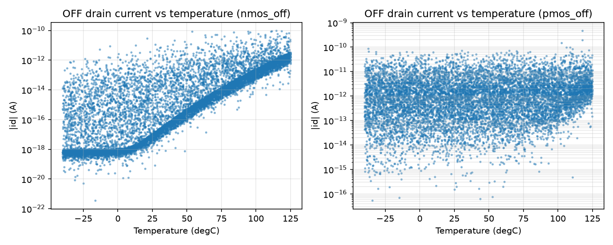
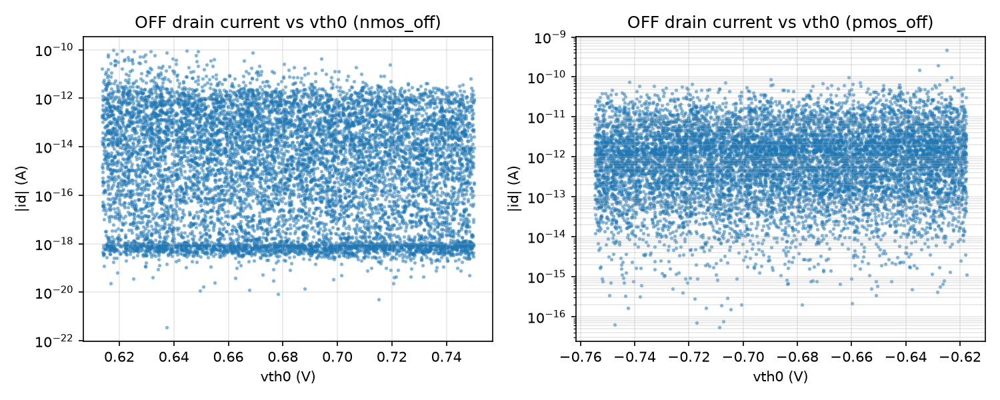
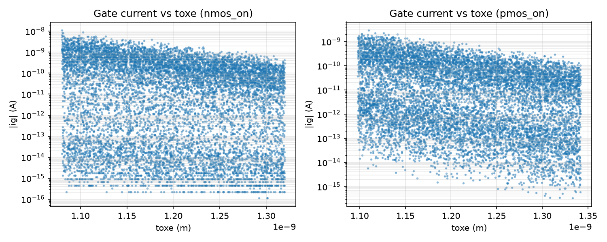
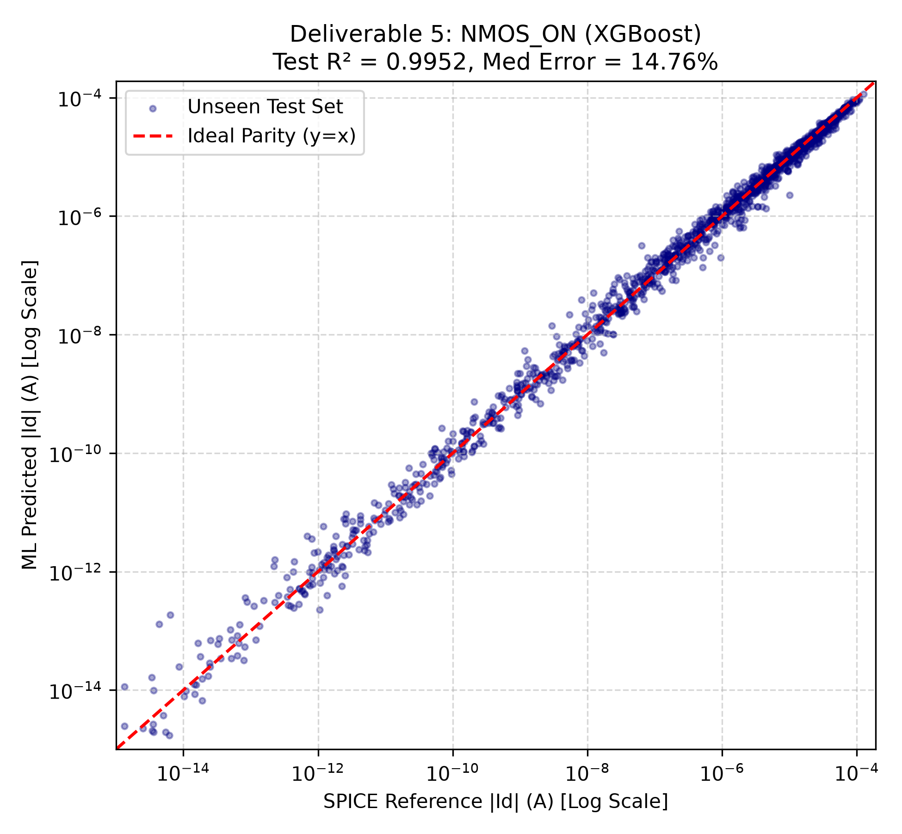
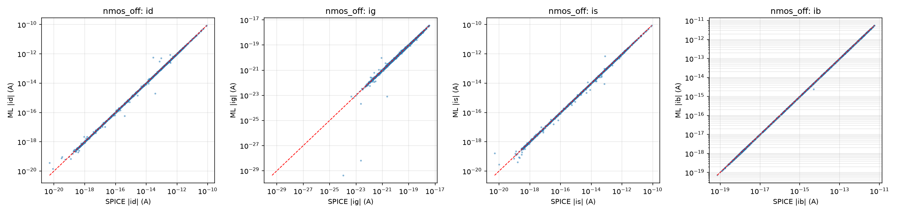
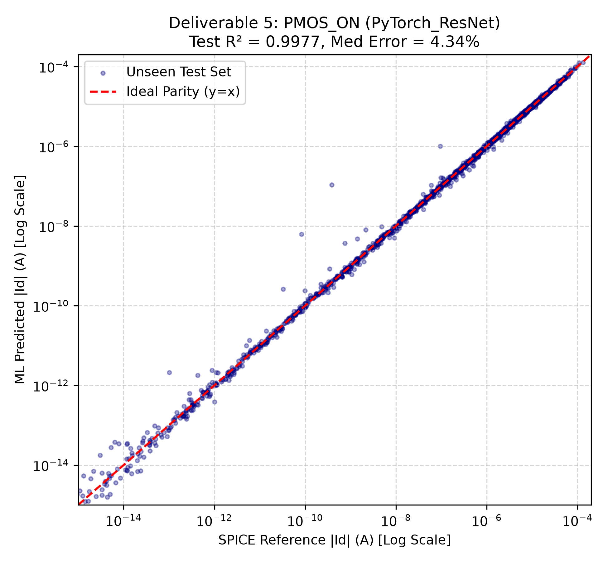
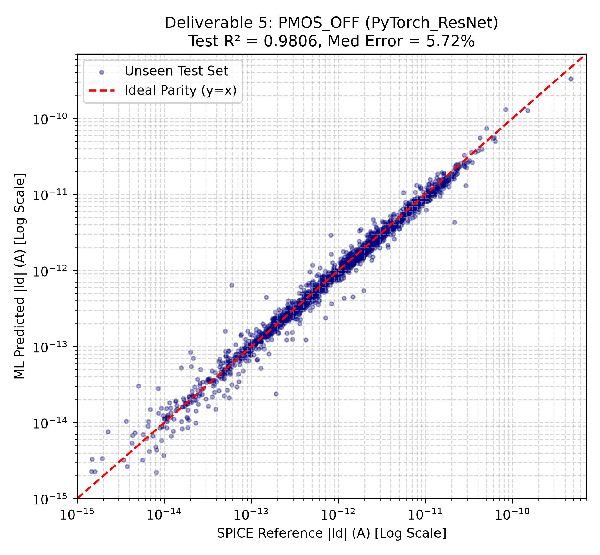

# Part A: Transistor Modeling and Characterization

## 1. Characterization Strategy and Parameter Sweeps

To capture device leakage across process, voltage, and temperature variations, 10,000 independent single-transistor operating points were simulated in ngspice for each of the four operating states:
* NMOS ON: Vg = VDD, Vb = 0 V
* NMOS OFF: Vg = 0 V, Vb = 0 V
* PMOS ON: Vg = 0 V, Vb = VDD
* PMOS OFF: Vg = VDD, Vb = VDD

Each sample was drawn independently at random from uniform distributions:
* Supply Voltage: VDD in [0.90 V, 1.10 V]
* Terminal Voltages: Vd in [0, VDD], Vs in [0, VDD]
* Transistor Width: W in [16 nm, 128 nm] (1x Lmin to 8x Lmin)
* Temperature: T in [-40.0 C, 125.0 C]
* Process Parameters (Uniform plus/minus 10% around nominal values):
  * NMOS: vth0 = 0.68191 V, toxe = 1.20 nm, ndep = 7.00e18 cm^-3, u0 = 0.0280 m^2/Vs, xj = 5.0 nm
  * PMOS: vth0 = -0.68620 V, toxe = 1.22 nm, ndep = 4.40e18 cm^-3, u0 = 0.0075 m^2/Vs, xj = 7.2 nm

Every netlist includes explicit diffusion parasitics using standard scalable layout rules:
Ldiff = 2.5 x Lmin = 40 nm
AD = AS = W x Ldiff
PD = PS = 2 x (W + Ldiff)

Adding explicit parasitics removed the default 10 fA numerical clamp in BSIM4, allowing physical diode reverse leakage and Band-to-Band Tunneling (BTBT) to be modeled down to low temperatures.

## 2. Kirchhoff Current Law (KCL) Data Audit

Every netlist connects each terminal to an isolated DC voltage source. Terminal currents entering the device are extracted as:
Id = -i(Vd), Ig = -i(Vg), Is = -i(Vs), Ib = -i(Vb)

By Kirchhoff Current Law, the sum of currents entering the four terminals must equal zero. Using set numdgt = 10 in ngspice, numerical truncation errors were eliminated.

| Case | Sample Count | Max Absolute Residual (A) | Median Relative Error (%) | Status |
|---|---|---|---|---|
| NMOS ON | 10,000 | 8.77e-10 | 0.0006% | Validated |
| NMOS OFF | 10,000 | 6.24e-16 | 0.0008% | Validated |
| PMOS ON | 10,000 | 2.56e-10 | 0.0005% | Validated |
| PMOS OFF | 10,000 | 2.33e-15 | 0.0007% | Validated |

In active states, maximum absolute residuals were dominated by SPICE Newton-Raphson convergence tolerances (reltol = 1e-6 multiplied by active currents of 140 uA). In leakage states, absolute residuals remained below 1e-15 A.

## 3. Physical Trend Verifications

Three physical trend plots were generated from the dataset to confirm that BSIM4 reproduced expected device physics:

### OFF Current vs. Temperature
Demonstrates exponential subthreshold rise from -40 C to 125 C.

### OFF Current vs. Threshold Voltage (vth0)
Demonstrates exponential decrease in subthreshold leakage as threshold voltage shifts higher by plus/minus 10%.

### Gate Current vs. Oxide Thickness (toxe)
Demonstrates steep exponential reduction in direct dielectric tunneling across the 1.08 nm to 1.34 nm physical range.

## 4. Machine Learning Model Comparison (Deliverable 4)

Datasets were split into 70% Training (7,000 samples), 15% Validation (1,500 samples), and 15% Unseen Testing (1,500 samples). Four model families were trained to predict log10(max(|I|, 1e-18 A)) across all four terminal currents (Id, Ig, Is, Ib):

Inputs to models: vdd, temp, w, vd, vs, vg, vb, vth0, toxe, ndep, u0, xj, plus electrical branch potential differences (vds, |vds|, vgs, vbs, vgd, overdrive).

Validation Set Results (Evaluated on all 4 targets, unfloored metric):

| Case | Model Architecture | Validation R2 (Log Space) | Median Relative Error (%) | 95th-Percentile Error (%) |
|---|---|---|---|---|
| NMOS ON | Ridge Regression | 0.8733 | 78.835 | 1653.12 |
| NMOS ON | Random Forest | 0.9832 | 22.794 | 127.66 |
| NMOS ON | XGBoost | 0.9895 | 14.509 | 82.04 |
| NMOS ON | PyTorch ResNet (250 epochs) | 0.9940 | 6.758 | 35.13 |
| NMOS OFF | Ridge Regression | 0.6614 | 59.687 | 1731.61 |
| NMOS OFF | Random Forest | 0.9381 | 7.561 | 91.53 |
| NMOS OFF | XGBoost | 0.9568 | 5.674 | 54.59 |
| NMOS OFF | PyTorch ResNet (250 epochs) | 0.9986 | 2.815 | 17.00 |
| PMOS ON | Ridge Regression | 0.8997 | 72.658 | 1627.95 |
| PMOS ON | Random Forest | 0.9864 | 24.444 | 132.38 |
| PMOS ON | XGBoost | 0.9926 | 16.186 | 83.87 |
| PMOS ON | PyTorch ResNet (250 epochs) | 0.9971 | 7.697 | 38.41 |
| PMOS OFF | Ridge Regression | 0.8546 | 41.205 | 1212.04 |
| PMOS OFF | Random Forest | 0.9514 | 15.049 | 365.78 |
| PMOS OFF | XGBoost | 0.9588 | 9.247 | 378.50 |
| PMOS OFF | PyTorch ResNet (250 epochs) | 0.9754 | 11.427 | 372.89 |

## 5. Chosen Models and Unseen Test Set Performance (Deliverable 5)

The PyTorch Deep ResNet architecture was selected as the operational model across all four cases. As demonstrated in diagnostic script 11, continuous neural networks with SiLU activations prevent the large boundary step errors that decision trees exhibit at rail voltages.

Final Test-Set Metrics (1,500 unseen samples):
* nmos_on (PyTorch ResNet): Mean R2 = 0.9946, Median Error = 6.995%, P95 Error = 34.38%
* nmos_off (PyTorch ResNet): Mean R2 = 0.9985, Median Error = 2.632%, P95 Error = 18.06%
* pmos_on (PyTorch ResNet): Mean R2 = 0.9971, Median Error = 7.583%, P95 Error = 39.44%
* pmos_off (PyTorch ResNet): Mean R2 = 0.9734, Median Error = 12.609%, P95 Error = 377.84%

### Test Set Parity Plots

