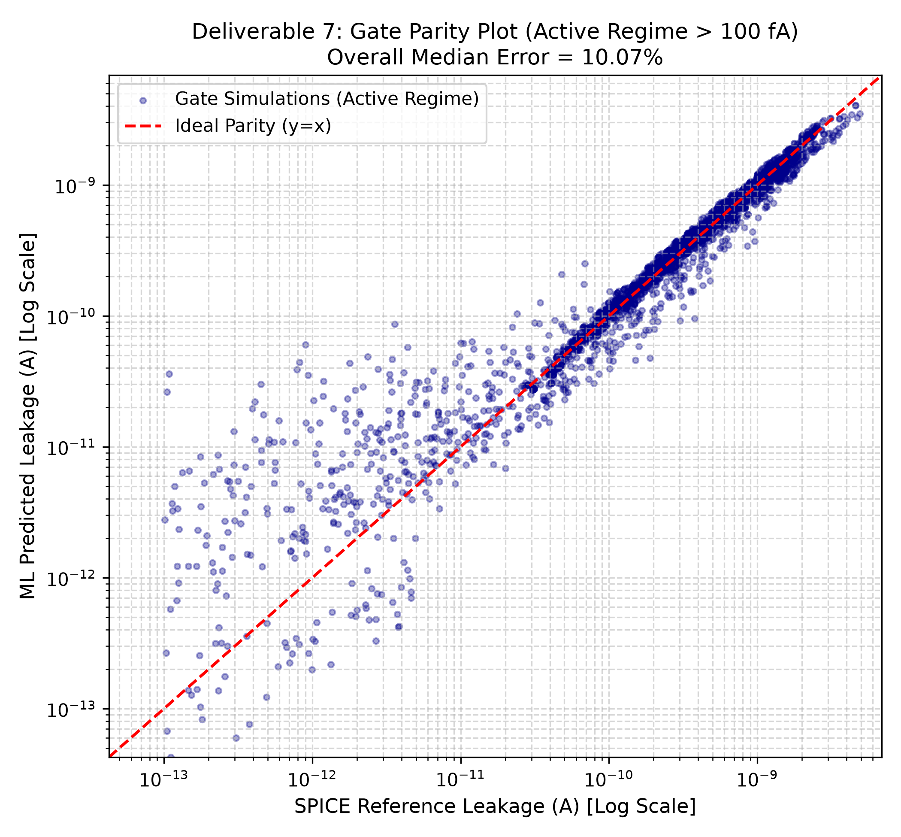

# Part B: Gate-Level Leakage Validation

Results for Deliverables 6 and 7. Interpretation is in `part_b_analysis.md`. The diagnostics behind the findings are in `diagnostics_and_experiments.md`.

| Step | Script | Output |
|---|---|---|
| 4 | `scripts/04_simulate_gates.py` | `results/gate_results_table.csv`, `results/plots/gate_parity_plot.png` |

The corner seed is fixed to 123 inside `04_simulate_gates.py`.

## 1. Gate topologies and netlists

Five static CMOS cells are built from the same transistors. Every NMOS is 32 nm wide (WN = 2 x Lmin) and every PMOS is 64 nm wide (WP = 4 x Lmin), with L = 16 nm. The diffusion rules are the same as in Part A: Ldiff = 2.5 x Lmin, AD = AS = W x Ldiff, PD = PS = 2 x (W + Ldiff).

* Inverter (INV): 1 PMOS pull-up, 1 NMOS pull-down. Inputs A = 0, 1.
* NAND2: 2 parallel PMOS pull-ups, 2 series NMOS pull-downs, internal node x between the NMOS. Inputs AB = 00, 01, 10, 11.
* NOR2: 2 series PMOS pull-ups with internal node y between them, 2 parallel NMOS pull-downs. Inputs AB = 00, 01, 10, 11.
* AND2: a NAND2 stage driving node n_out, followed by an inverter driving out. Simulated as one netlist.
* OR2: a NOR2 stage driving node n_out, followed by an inverter driving out. Simulated as one netlist.

The decks are generated inside `simulate_gate_spice` in `04_simulate_gates.py`, one per gate, input pattern and corner. Each uses `.nodeset` hints for the output and internal nodes, `gmin = abstol = 1e-18`, `reltol = 1e-6` and `itl1 = 400`, and solves a `.op` with a 10 s timeout. The supply leakage is I_leak = -i(Vdd). The output voltage and the internal node voltages (x, y, n_out) are recorded for the ML step.

Total: 18 gate cases x 200 random PVT corners = 3,600 SPICE runs. The corners use seed 123 and are drawn from these ranges:

| Quantity | Range |
|---|---|
| Supply voltage VDD | 0.90 V to 1.10 V |
| Temperature T | -40 C to 125 C |
| Process parameters (vth0, toxe, ndep, u0, xj) | plus/minus 10% around the nominal value, drawn independently for the NMOS and the PMOS |

## 2. ML prediction method

Following the project specification (Section 3, Step 4), the output and internal node voltages recorded from SPICE set the drain and source voltages of each transistor. The gate and body voltages follow from the input pattern. The Part A models predict all four terminal currents of each transistor as magnitudes, and `predict_gate_leakage` sums the terms below.

| Gate, input | Output | Terms summed from the transistor models |
|---|---|---|
| INV 0 | high | NMOS OFF Id (drain out, source 0) + PMOS ON Ig |
| INV 1 | low | PMOS OFF Id (drain out, source Vdd) |
| NAND2 00 | high | NMOS OFF Id (drain out, source x) + 2 x PMOS ON Ig |
| NAND2 01 | high | NMOS OFF Id (drain out, source x) + PMOS ON Ig |
| NAND2 10 | high | NMOS OFF Id (drain x, source 0) + PMOS ON Ig |
| NAND2 11 | low | 2 x PMOS OFF Id (drain out, source Vdd) |
| NOR2 00 | high | 2 x NMOS OFF Id (drain out, source 0) + PMOS ON Ig (drain y, source Vdd) + PMOS ON Ig (drain out, source y) |
| NOR2 01 | low | PMOS OFF Id (drain out, source y) + PMOS ON Ig (drain y, source Vdd) |
| NOR2 10 | low | PMOS OFF Id (drain y, source Vdd) |
| NOR2 11 | low | PMOS OFF Id (drain y, source Vdd) |
| AND2 | | NAND2 term (output n_out) + INV term (input pattern set by n_out > Vdd/2) + interstage term |
| OR2 | | NOR2 term (output n_out) + INV term (input pattern set by n_out > Vdd/2) + interstage term |

The interstage term is the NMOS ON Ig of the inverter (drain out, source 0, gate n_out). It is added only when n_out is high.

**Output-low states.** In the final code the OFF PMOS contributes its drain current |Id|. Scripts 08 and 10 show that |Id| is not the quantity the supply delivers: it includes gate-edge tunneling that the input source supplies, not Vdd. The Kirchhoff formulation (Is of the PMOS whose source is on Vdd plus Ib of every PMOS) matches full-gate SPICE to 0.0076% (INV 1, NAND2 11) and to within 0.42% (all four states) when it is fed true SPICE currents. That fix was diagnosed after the Part B method was fixed and is not applied in the results below. See `part_b_analysis.md`, section 4.

## 3. Deliverable 6: Gate results table

Error statistics use only samples with SPICE leakage above 1e-13 A. The SPICE median, ML median and bias columns use every run with a non-zero SPICE leakage. The n column gives the number of runs above the 1e-13 A floor.

| Gate | Input | n (>1e-13 A) | SPICE median (A) | ML median (A) | Median bias (A) | Median error (%) | P95 error (%) |
|---|---|---|---|---|---|---|---|
| INV | 0 | 200 | 2.251e-10 | 2.485e-10 | +1.023e-11 | 8.40 | 25.30 |
| INV | 1 | 197 | 1.491e-11 | 2.037e-11 | +1.031e-12 | 52.71 | 1859.49 |
| NAND2 | 00 | 200 | 4.088e-10 | 4.440e-10 | +1.427e-11 | 8.56 | 25.38 |
| NAND2 | 01 | 200 | 2.251e-10 | 2.485e-10 | +1.023e-11 | 8.40 | 25.30 |
| NAND2 | 10 | 200 | 2.106e-10 | 2.314e-10 | +8.107e-12 | 8.88 | 25.27 |
| NAND2 | 11 | 200 | 2.980e-11 | 4.074e-11 | +2.062e-12 | 53.77 | 2127.79 |
| NOR2 | 00 | 200 | 4.503e-10 | 4.970e-10 | +2.046e-11 | 8.39 | 25.30 |
| NOR2 | 01 | 200 | 2.508e-10 | 2.638e-10 | +3.722e-12 | 9.55 | 26.42 |
| NOR2 | 10 | 152 | 8.504e-13 | 4.787e-12 | +2.174e-12 | 144.15 | 2735.71 |
| NOR2 | 11 | 58 | 1.109e-14 | 4.633e-14 | +1.085e-14 | 68.18 | 87.89 |
| AND2 | 00 | 192 | 9.391e-10 | 9.307e-10 | -3.713e-12 | 6.62 | 22.76 |
| AND2 | 01 | 199 | 6.751e-10 | 6.471e-10 | -1.074e-11 | 6.09 | 22.11 |
| AND2 | 10 | 196 | 6.725e-10 | 6.479e-10 | -1.075e-11 | 5.84 | 24.80 |
| AND2 | 11 | 200 | 3.154e-10 | 3.239e-10 | +4.591e-12 | 11.77 | 29.48 |
| OR2 | 00 | 200 | 9.207e-10 | 9.443e-10 | -2.949e-12 | 6.25 | 17.46 |
| OR2 | 01 | 200 | 4.871e-10 | 5.126e-10 | +8.344e-12 | 8.38 | 23.64 |
| OR2 | 10 | 200 | 2.279e-10 | 2.532e-10 | +1.207e-11 | 9.04 | 24.98 |
| OR2 | 11 | 200 | 2.265e-10 | 2.486e-10 | +9.726e-12 | 8.48 | 25.30 |

* **Part B overall median error: 10.07%.** It is the median of the pooled relative errors of the 3,394 runs above 1e-13 A. It is not an average of the per-state medians.
* 206 of the 3,600 runs are excluded. 13 are failed SPICE runs (all AND2, see section 5). 193 are below the 1e-13 A floor: 142 of them in NOR2 11, 48 in NOR2 10 and 3 in INV 1.
* Excluding the four states with the highest error (INV 1, NAND2 11, NOR2 10, NOR2 11), the overall median is 8.22% and the 95th percentile is 25.29%. Those four states hold 607 of the 3,394 runs (17.9%) and have a pooled median error of 63.10%.
* The per-state results are also in `results/gate_results_table.csv`.

## 4. Deliverable 7: Gate parity plot

The parity plot shows the 3,394 runs above 1e-13 A (100 fA) on log-log axes against the ideal y = x line. The SPICE leakage of these runs spans 1.0e-13 A to 4.9e-9 A.

## 5. Notes on the data

* **Failed SPICE runs.** In 13 gate runs the SPICE leakage came back as exactly 0 (all AND2: 8 at input 00, 1 at 01, 4 at 10, at 12 different corners). `simulate_gate_spice` returns 0 when ngspice times out or prints no leakage line, and it falls back to default node voltages. Part B skips these runs. Part C does not skip them (`part_c_circuit_validation.md`, section 5).
* **Noise floor.** The 1e-13 A filter is a choice made for the error statistics. It removes most of NOR2 11 (whose SPICE median is 1.1e-14 A), so its error figure rests on 58 runs.