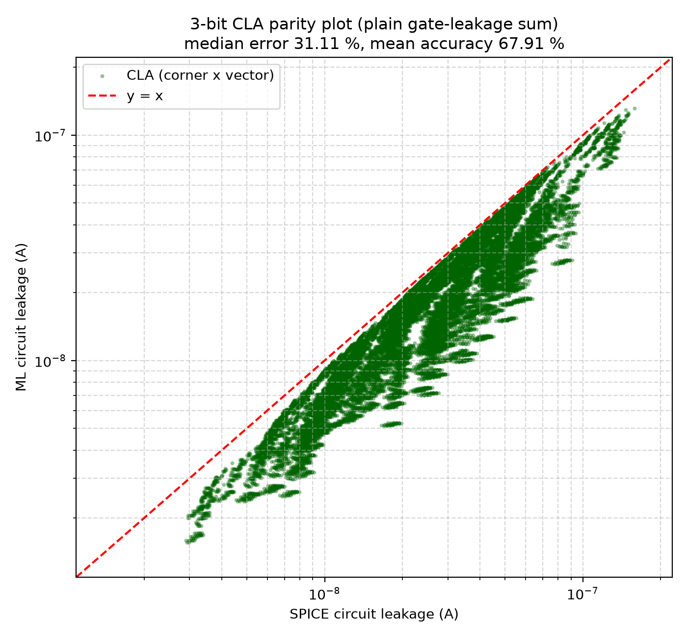
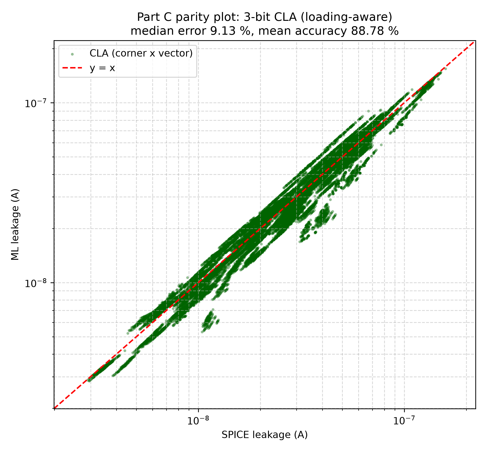

# Part C: Test-Circuit Validation (3-Bit Carry-Lookahead Adder)

## 1. Architecture of the 3-Bit CLA

The test circuit is a 3-bit Carry-Lookahead Adder built exclusively from the five Part B cells (42 logic gates, 204 transistors):
* Inputs: a[2:0], b[2:0], cin (7 binary inputs = 128 input vectors)
* Outputs: s[2:0], cout
* Bitwise Propagate and Generate:
  * P_i = A_i XOR B_i (each XOR built from 4 NAND2 gates)
  * G_i = A_i AND B_i (AND2 gates)
* Lookahead Carry Generator:
  * C1 = G0 + P0.Cin (AND2, OR2)
  * C2 = G1 + P1.G0 + P1.P0.Cin (AND2, OR2)
  * C3 = G2 + P2.G1 + P2.P1.G0 + P2.P1.P0.Cin (AND2, OR2 tree, Cout = C3)
* Sum Generation:
  * S_i = P_i XOR C_i (each XOR built from 4 NAND2 gates)

## 2. Simulation Setup and Golden Reference

The complete transistor-level netlist (`netlists/circuit/cla3.sp`) was simulated in ngspice across all 128 input vectors at the same 200 random PVT corners used in Part B:
* Total full-circuit SPICE runs: 128 vectors x 200 corners = 25,600 simulations.
* Static supply leakage current was extracted via the operating point supply current: I_leak = -i(Vdd).
* Logic functionality was validated for every run: zero logic mismatches across all 25,600 simulations.

## 3. The 32.25% Structural Gap: Control Experiment

To determine whether the error in Part C stemmed from machine learning surrogate error or from circuit-level interconnection physics, a pure SPICE control experiment was conducted (script 05):
* Method: Sum the exact SPICE gate leakages from isolated runs across all 42 gates for each vector and corner, and compare directly against the full-circuit SPICE netlist. Zero machine learning was involved.

Control Experiment Results:
* SPICE Full-Circuit Median: 2.687e-08 A (26.87 nA)
* SPICE Gate-Sum Median: 1.735e-08 A (17.35 nA)
* Structural Gap Median Error: 32.25% (P95 Error: 61.83%, Bias: -6.37e-09 A)

Conclusion:
Summing isolated gates under-predicts the real circuit by 32.25% in pure SPICE. This discrepancy is structural: isolated gate simulations connect input pins to ideal voltage sources, so receiver gate tunneling is supplied externally. In a full circuit, the driving gate's PMOS pull-up must supply that tunneling current from the chip's VDD rail.

## 4. Deliverable 8: Test-Circuit Results

Two hierarchical models were evaluated:
1. Plain Hierarchical Sum (Headline - Deliverable 8): Evaluates gate inputs at ideal logic levels (0 or VDD) and sums isolated gate models, ignoring inter-gate loading as specified in Section 5.
2. Loading-Aware Model (Physical Improvement): Augments the plain sum with the gate tunneling current drawn by downstream NMOS-ON receiver pins driven by internal nets (_pin_loading_ig).

Summary Metrics (25,600 full-circuit runs):

| Metric | Full-Circuit SPICE | Plain Hierarchical Sum (Headline) | Loading-Aware Model (Improvement) |
|---|---|---|---|
| Median Leakage Current | 2.687e-08 A | 1.771e-08 A | 2.666e-08 A |
| Median Bias | -- | -6.362e-09 A | -5.278e-11 A |
| Median Relative Error | -- | 32.41% | 8.42% |
| 95th-Percentile Error | -- | 62.41% | 21.62% |
| Mean Relative Error | -- | 32.58% | 9.80% |
| Mean Accuracy | -- | 67.42% | 90.20% |

* Best Vector: Vector 0111111 (A=7, B=7, Cin=0) achieved 2.14% median error.
* Worst Vector: Vector 0000000 (A=0, B=0, Cin=0) had 13.88% median error.

### Part C Parity Plots

#### Plain Hierarchical Sum (Headline Result)
Demonstrates the systematic downward shift caused by ignoring fan-out gate tunneling.

#### Loading-Aware Model (Physics Improvement)
Adding receiver gate tunneling eliminates the systematic bias, centering the scatter directly on y = x.

