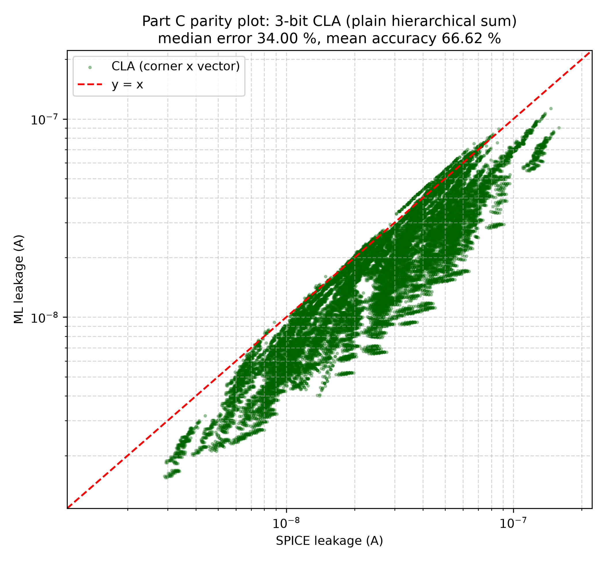
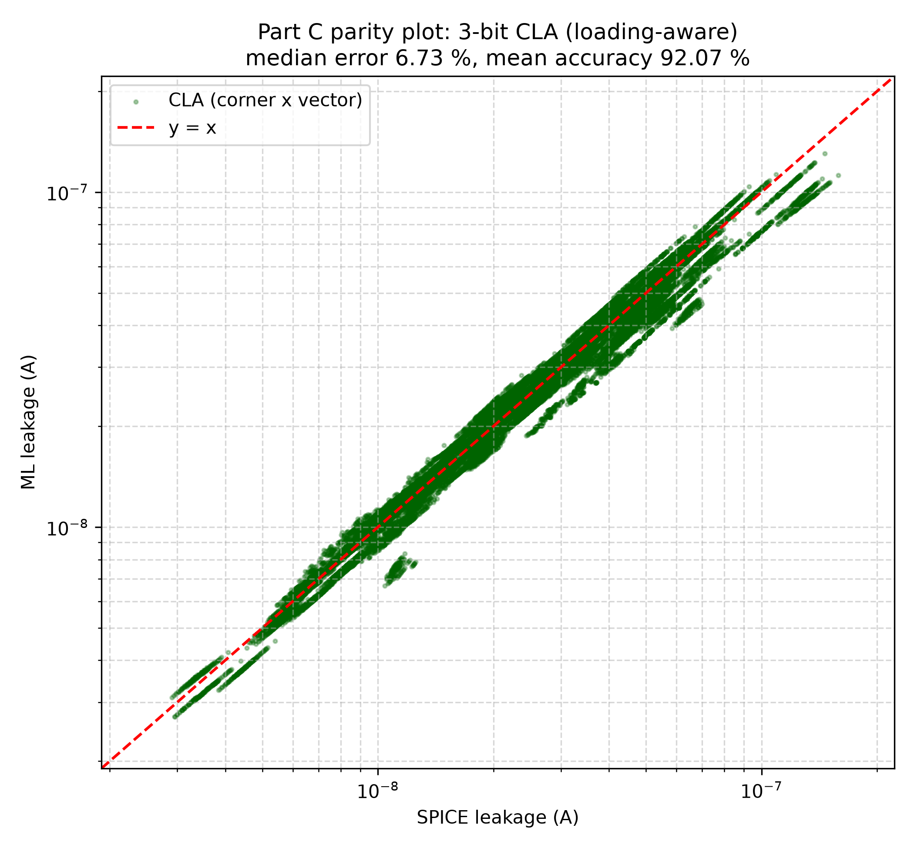

# Part C: Test-Circuit Validation (3-Bit Carry-Lookahead Adder)

Results for Deliverable 8. Interpretation is in `part_c_analysis.md`. The diagnostics are in `diagnostics_and_experiments.md`.

| Step | Script | Output |
|---|---|---|
| 5 | `scripts/05_test_circuit.py --seed 123` | `results/circuit_results_table.csv`, `results/part_c/circuit_raw.csv`, `results/plots/circuit_parity_plot.png`, `results/plots/circuit_parity_plot_loading.png`, `netlists/circuit/cla3.sp` |

The reported results use `--seed 123`, which gives the same 200 corners as Part B. The script's built-in default is 7.

## 1. Architecture of the 3-bit CLA

The circuit is built only from Part B cells: 42 logic gates and 204 transistors (24 NAND2, 12 AND2 and 6 OR2). All 24 NAND2 cells form the 6 XORs (4 NAND2 each). The circuit has no standalone INV or NOR2 cells.

* Inputs: a[2:0], b[2:0], cin (7 binary inputs, 128 input vectors)
* Outputs: s[2:0], cout
* Bitwise propagate and generate:
  * P_i = A_i XOR B_i (each XOR built from 4 NAND2 gates)
  * G_i = A_i AND B_i (AND2 gates)
* Lookahead carry generator:
  * C1 = G0 + P0.Cin (AND2, OR2)
  * C2 = G1 + P1.G0 + P1.P0.Cin (AND2, OR2)
  * C3 = G2 + P2.G1 + P2.P1.G0 + P2.P1.P0.Cin (AND2, OR2 tree, Cout = C3)
* Sum generation:
  * S_i = P_i XOR C_i (each XOR built from 4 NAND2 gates)

Across the 128 vectors the CLA uses 11 of the 18 gate states: all four AND2 and four NAND2 states, and OR2 00, 01 and 10. INV, NOR2 and OR2 11 never occur as top-level gate states.

## 2. Simulation setup and golden reference

The transistor-level netlist (`netlists/circuit/cla3.sp` shows the nominal-corner example for one vector) is simulated in ngspice for all 128 input vectors at the same 200 PVT corners as Part B (seed 123).

* Full-circuit SPICE runs: 128 vectors x 200 corners = 25,600.
* Static supply leakage is the operating-point supply current, I_leak = -i(Vdd). The primary inputs are separate ideal sources and are not on the Vdd current.
* The `.nodeset` hints give each gate's output and internal nodes their expected logic values.
* All 25,600 runs returned a valid leakage value, and the circuit outputs matched the expected sum in every run (0 failed runs, 0 logic mismatches).

## 3. Control experiment: summing isolated gates in SPICE

To separate machine learning error from circuit-level physics, the isolated-gate SPICE leakages (no ML) are summed over the 42 gates for each vector and corner and compared with the full-circuit SPICE leakage.

* Full-circuit SPICE median: 2.687e-08 A (26.87 nA)
* Gate-sum median: 1.735e-08 A (17.35 nA)
* Median error: 32.25% (95th percentile 61.83%, median bias -6.373e-09 A)

Summing isolated gates under-predicts the real circuit by about a third, with no ML involved. The cause is explained in `part_c_analysis.md`, section 2.

## 4. Deliverable 8: Test-circuit results

Two hierarchical ML models are evaluated:

1. **Plain hierarchical sum (headline result).** Gate inputs sit at ideal logic levels (0 or VDD), and the isolated-gate ML predictions are summed. Inter-gate loading is ignored, as the project specifies.
2. **Loading-aware model (physical improvement).** The plain sum plus the gate tunneling current that each gate input driven by an internal net draws from the driving gate (`_pin_loading_ig` in `05_test_circuit.py`). For every such input at logic 1 it adds the ML-predicted Ig of the NMOS ON and of the OFF PMOS connected to that pin.

Summary metrics over the 25,600 full-circuit runs:

| Metric | SPICE gate sum (control) | Plain hierarchical sum (headline) | Loading-aware model (improvement) |
|---|---|---|---|
| Full-circuit SPICE median leakage | 2.687e-08 A | 2.687e-08 A | 2.687e-08 A |
| Median leakage of the estimate | 1.735e-08 A | 1.752e-08 A | 2.643e-08 A |
| Median bias | -6.373e-09 A | -6.360e-09 A | -2.159e-10 A |
| Median relative error | 32.25% | 34.0% | 6.732% |
| 95th-percentile error | 61.83% | 62.94% | 21.37% |
| Mean relative error | -- | 33.38% | 7.93% |
| Mean accuracy | -- | 66.62% | 92.07% |

* Per-vector medians for both models are in `results/circuit_results_table.csv`.
* Errors use runs above 1e-13 A, which is every run (full-circuit leakage is at least about 4 nA).

### Part C parity plots

Both plots show 25,600 points (corner x vector) against the y = x line on log-log axes.

#### Plain hierarchical sum (headline result)
The points lie systematically below y = x: the estimate is lower than SPICE by 34.0% in the median.

#### Loading-aware model
The points follow y = x over roughly 4 nA to 150 nA of SPICE leakage. The median error is 6.73% and the mean accuracy is 92.07%.

## 5. Notes on the data

* **Failed gate runs.** The gate-level SPICE runs behind both models include 13 failed AND2 runs (SPICE leakage returned as 0, see `part_b_gate_validation.md`, section 5). Part C does not exclude them. Of the 25,600 circuit instances, 1,328 (5.19%) use at least one of them. In those instances the SPICE gate-sum is missing that gate's leakage, and the ML estimate for that gate used default node voltages instead of the simulated ones. A single AND2 leakage (about 1e-10 A to 9e-10 A) is 1% to 3% of the median circuit leakage, so the effect on the medians is expected to be small. It has not been quantified.
* **Gate inputs at ideal levels.** Both models take the gate-level ML values from isolated-gate runs with ideal input levels and use the node voltages (x, y, n_out) from those isolated runs.